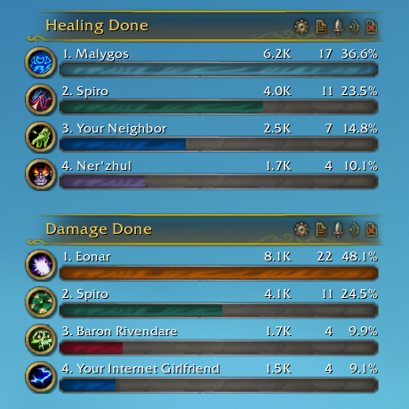

# Details! - Skin 'The War Within'

World of Warcraft addon that adds the **'The War Within'** skin (inspired by **/u/Sm0keO**) to **Details!**.

View on CurseForge: <https://www.curseforge.com/wow/addons/details-skin-the-war-within>

> **2.0 rewrite in progress.** The addon is being rebuilt from scratch for Midnight and all current
> clients (Retail, Mists Classic, Anniversary, Classic Era, WoW Forever). The skin itself is not
> ported yet; the pre-2.0 addon is kept in [`legacy/`](legacy/) for reference.

## Features

<!-- TODO -->

## Installation

Download it from CurseForge or the GitHub releases and put the `Details_TWW` folder into
`..\World of Warcraft\<client>\Interface\AddOns`. Skins the game's built-in damage meter;
[Details!](https://www.curseforge.com/wow/addons/details) support is optional and coming later.

## Usage

- `/tww` (or `/details_tww`) — open the options
- `/tww loglevel <level>` — set how much the addon writes to chat (`none`, `error`, `warn`, `info`,
  `verbose`, `debug`, `silly`)
- `/tww reset` — reset the current profile

## Development

Node 20+; run `npm install` once. `npm run dev:link -- "<WoW>/Interface/AddOns"` links the addon
into a client, `/reload` picks up changes. `npm run format` formats everything, `npm run check`
validates it. Releases are built by the GitHub workflows in `.github/workflows/`.

## Support

If you want to support the development, like and share, but if you're feeling extra kind, you can
[buy me a slice of pizza](https://www.buymeacoffee.com/karlheinzschneider). Thanks!

## Preview

## License

[MIT](LICENSE)
