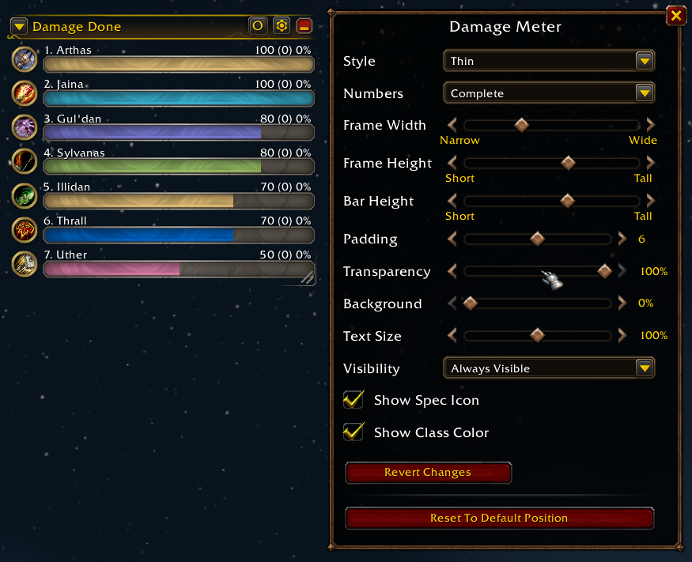
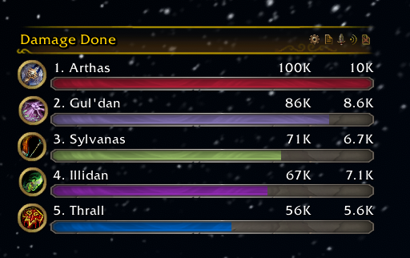

# Details! - Skin 'The War Within'

World of Warcraft addon that adds the **'The War Within'** skin (inspired by **/u/Sm0keO**) to the
game's built-in damage meter and to **Details!**.

View on CurseForge: <https://www.curseforge.com/wow/addons/details-skin-the-war-within>

> **Version 2.0 is a complete remake.** The addon was rebuilt from scratch for Midnight and every
> current client, and it will be maintained from now on.

## Features

- Skins Blizzard's damage meter: TWW header, cast bar style bars, round class icons and Friz
  Quadrata text. Works with every Edit Mode style, the style only changes the bar size.
- Adds a 'The War Within' skin to Details! (optional). Pick it in the Details! skin list or use
  "Apply to all Details! windows" in the options; your windows are never changed on their own.
- Default or bright bar texture.
- Retail, Mists Classic, Anniversary, Classic Era and WoW Forever.

## Installation

Download it from CurseForge or the GitHub releases and put the `Details_TWW` folder into
`..\World of Warcraft\<client>\Interface\AddOns`.

## Usage

- `/tww` (or `/details_tww`) — open the options
- `/tww loglevel <level>` — set how much the addon writes to chat (`none`, `error`, `warn`, `info`,
  `verbose`, `debug`, `silly`)
- `/tww reset` — reset the current profile

## Development

Node 20+; run `npm install` once. `npm run dev:link -- "<WoW>/Interface/AddOns"` links the addon
into a client, `/reload` picks up changes. `npm run format` formats everything, `npm run check`
validates it. Releases are built by the GitHub workflows in `.github/workflows/`.

## Support

If you want to support the development, like and share, but if you're feeling extra kind, you can
[buy me a slice of pizza](https://www.buymeacoffee.com/karlheinzschneider). Thanks!

## Preview

Blizzard damage meter:

Details!:

## License

[MIT](LICENSE)
